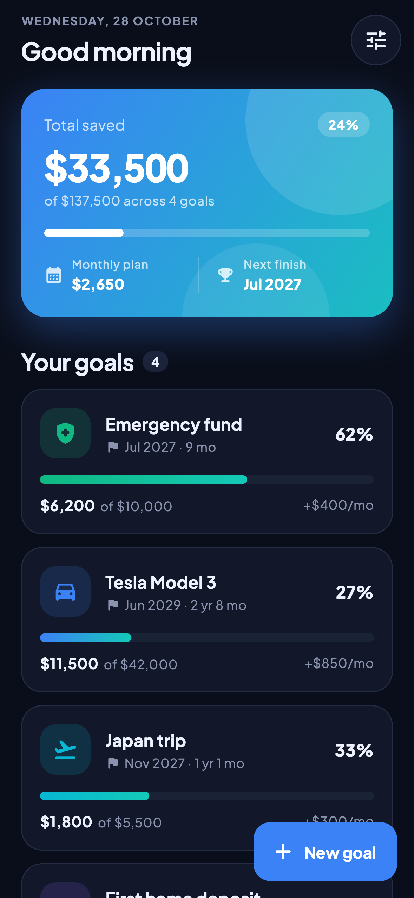
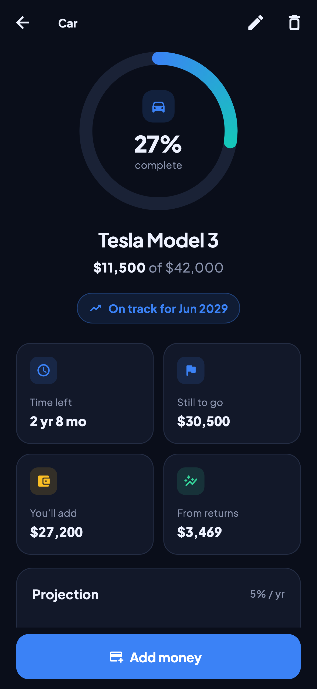
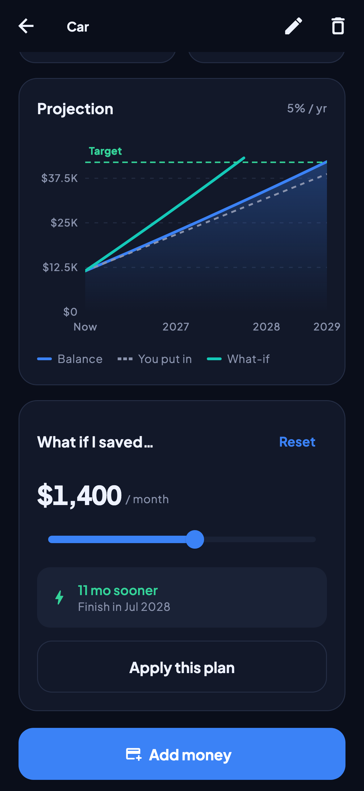
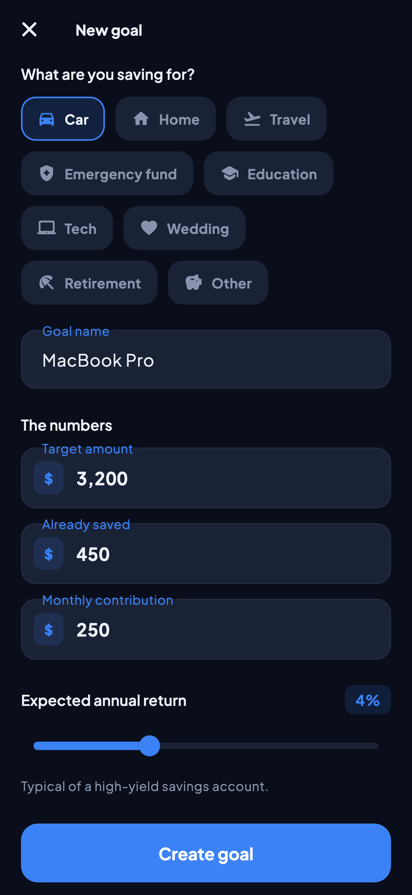
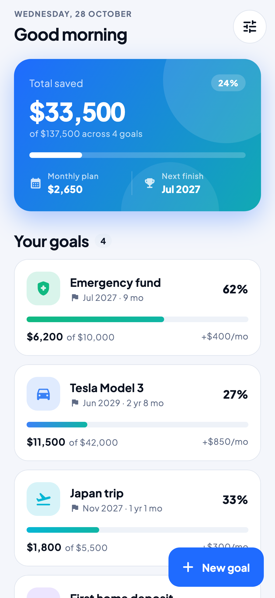
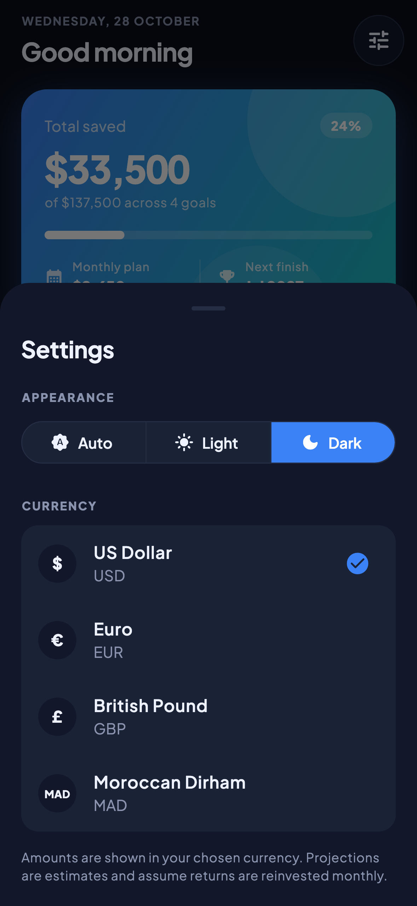

<p align="center">
  
</p>

<h1 align="center">Horizon</h1>

<p align="center">
  A goal-based savings planner for iOS & Android, built with Flutter.<br/>
  Set a target, see exactly when you'll hit it, and find out how much faster you could get there.
</p>

<p align="center">
  
  
  
</p>

## Features

- **Multiple goals:** car, home, travel, emergency fund and more, each with its own target, starting balance, monthly plan and expected return.
- **Compound-growth projections:** month-by-month simulation with monthly compounding, so the finish date reflects returns as well as raw contributions.
- **Interactive projection chart:** balance against what you actually put in, with the target line and touch tooltips.
- **What-if simulator:** drag a slider to try a different monthly amount. A comparison curve and "N months sooner" appear instantly, and one tap applies the new plan.
- **Milestones:** 25 / 50 / 75 / 100 % checkpoints with projected dates.
- **Deposits & withdrawals:** log money in or out, with quick-add chips and an activity feed.
- **Live forecast while editing:** the editor shows when you'll finish as you type, with grouped thousands (`12,500`).
- **Dashboard:** total saved across all goals, overall progress, monthly commitment and the next goal to finish.
- **Dark & light themes, four currencies:** USD, EUR, GBP and MAD, saved between launches.
- **Polish:** animated progress rings and count-ups, staggered list entrances, hero transitions, haptics, and undo on delete.

<p align="center">
  
  
  
</p>

## Architecture

```
lib/
├── main.dart                  # bootstraps storage, keeps the splash until data is loaded
├── app.dart                   # MaterialApp + theme mode
├── core/
│   ├── theme/                 # design tokens (AppPalette ThemeExtension) + Material 3 theme
│   └── format/                # money / date / duration formatting
├── models/                    # Goal, Deposit, GoalCategory, Currency (immutable, JSON-serialisable)
├── services/
│   └── savings_calculator.dart  # pure projection math, no Flutter or I/O
├── data/
│   └── goal_repository.dart   # storage interface + SharedPreferences / in-memory impls
├── state/
│   └── goals_store.dart       # ChangeNotifier (provider), single source of truth
├── screens/                   # home · goal_detail · goal_editor · settings
└── widgets/                   # ProgressRing, ProjectionChart, AmountField, GoalCard, …
```

**Design decisions**

- **The math is pure and isolated.** `SavingsCalculator` takes numbers and returns a `Projection`, so it's trivially unit-tested and reused by the cards, chart, milestones, editor preview and what-if simulator.
- **Storage sits behind an interface.** `GoalsStore` only knows about `GoalRepository`, so tests inject `InMemoryGoalRepository` and a fixed clock for fully deterministic runs.
- **Design tokens, not hard-coded colors.** Every brand color lives in one `AppPalette` theme extension with light and dark variants. Widgets read `context.palette`.
- **Edge cases are handled explicitly:** targets that can't be reached (no contributions and no growth), plans capped at 100 years, already-completed goals, and calendar-safe month arithmetic (Jan 31 + 1 month = Feb 28/29).

## Getting started

```bash
flutter pub get
flutter run
```

On first launch the app seeds a few sample goals so there's something to explore. Delete them any time.

## Tests

```bash
flutter test                                   # unit + widget tests
flutter test tool/screenshots --update-goldens # regenerate the README screenshots
```

The suite covers the projection math (including an annuity round-trip and month/year edge cases), the store (CRUD, undo, deposits, totals, persistence) and end-to-end widget flows: create a goal with validation, open a goal, apply a what-if plan, and delete with undo.

## Tech

Flutter 3 · Dart 3 · Material 3 · [provider](https://pub.dev/packages/provider) · [fl_chart](https://pub.dev/packages/fl_chart) · [shared_preferences](https://pub.dev/packages/shared_preferences) · [intl](https://pub.dev/packages/intl) · [Plus Jakarta Sans](https://fonts.google.com/specimen/Plus+Jakarta+Sans) (OFL, bundled)

> Projections are estimates for planning purposes and assume a constant rate of return. They aren't financial advice.
